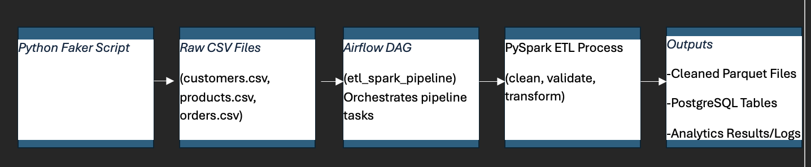
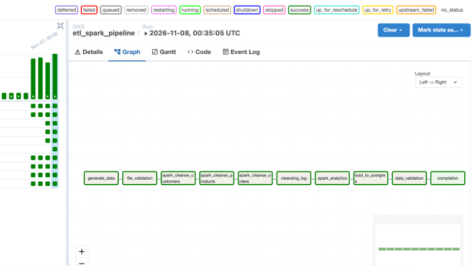
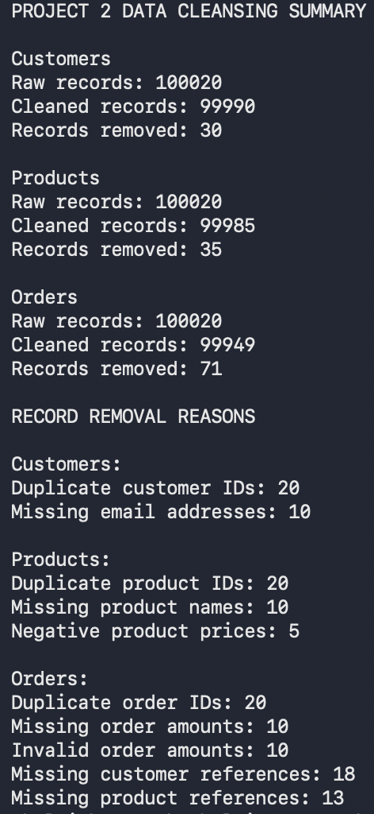
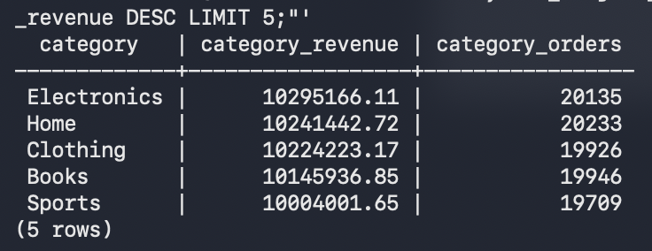
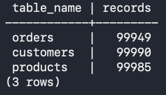

# Python Project 2: Apache Airflow and Spark ETL Pipeline

## 1. Introduction

For Project 2, I created an ETL (Extract, Transform, Load) pipeline using Python, Apache Airflow, Apache Spark (PySpark), PostgreSQL, and Docker. The goal was to build a pipeline that could handle a much larger amount of data while also checking for data-quality issues and producing useful analytics.

For the business scenario, I used customer, product, and order information from a simulated retail company. A business could use this information to better understand customer spending, product performance, inventory, and sales trends. However, the data needs to be cleaned and organized before it can be used for reporting.

This project builds on Project 1, where I worked with smaller datasets and used Python, PostgreSQL, and Apache NiFi to move data through a pipeline. Project 2 expanded the process to approximately 100,000 records per dataset and introduced Apache Spark for distributed data processing and Apache Airflow for workflow orchestration.

My main goals were to generate sample data, introduce and resolve data-quality issues, calculate analytics, load the results into PostgreSQL, and test the complete process.

## 2. Architecture

I used Docker Compose to run the different services needed for the project. The main components were Apache Airflow, Apache Spark, and PostgreSQL.

Airflow was responsible for organizing the workflow and making sure the tasks ran in the correct order. Spark handled the larger data-processing jobs, including cleansing and analytics. PostgreSQL stored the cleaned records, analytics results, and audit information.

The pipeline followed this general process:

**Faker Data Generation → Raw CSV Files → PySpark Cleansing → Cleaned Parquet Files → PySpark Analytics → PostgreSQL**

Airflow controlled the process through a DAG named `etl_spark_pipeline`.

The DAG contained ten tasks, beginning with data generation and file validation. It then ran three separate cleansing tasks for customers, products, and orders. After cleansing, it generated a data-quality log, calculated analytics, loaded PostgreSQL, validated the database, and completed the workflow.

*Figure 1. Project 2 architecture showing how Airflow orchestrates data generation, PySpark cleansing and analytics, and PostgreSQL loading.*

*Figure 2. Completed Apache Airflow DAG showing all ten ETL tasks executed successfully.*

## 3. Data Quality

One important part of this project was introducing data-quality problems into the sample data and then using Spark to identify and correct them.

I generated 100,000 customers, 100,000 products, and 100,000 orders, with 20 additional duplicate records added to each dataset.

The data-quality problems included duplicate IDs, missing email addresses, missing product names, negative prices, missing order amounts, invalid order amounts, and orders referencing nonexistent customers or products. I also standardized capitalization, whitespace, and dates.

I created separate PySpark scripts for each dataset. The scripts removed invalid records, corrected formatting, and saved the cleaned results as Parquet files.

### Before and After Cleansing

| Dataset | Raw Records | Cleaned Records | Removed |
|---|---:|---:|---:|
| Customers | 100,020 | 99,990 | 30 |
| Products | 100,020 | 99,985 | 35 |
| Orders | 100,020 | 99,949 | 71 |
| **Total** | **300,060** | **299,924** | **136** |

The customer dataset lost 20 duplicates and 10 records with missing emails. Products lost 20 duplicates, 10 records with missing product names, and 5 with negative prices.

The order dataset lost 20 duplicate records, 10 records with missing amounts, 10 with invalid amounts, 18 with missing customer references, and 13 with missing product references.

I also created `cleansing_log.py`, which automatically saves the raw record counts, cleaned counts, and reasons for record removal to `cleansing_summary.txt`.

*Figure 3. Data-quality summary showing raw and cleaned record counts and reasons for removing invalid records.*

## 4. Analytics Results

After cleansing, I used PySpark to calculate 13 analytics datasets. These results help explain different parts of customer behavior, product performance, and sales activity.

The customer analytics included lifetime spending, order frequency, and average order value. Product analytics included revenue and how often each product was ordered.

I also calculated category performance, average product prices, inventory status, daily and monthly sales, order status summaries, payment method summaries, average discounts, revenue by customer type, categories purchased by customer type, and city-level revenue.

The results were saved as Parquet files before being loaded into PostgreSQL.

### Analytics Outputs

| Analytics Dataset | Purpose |
|---|---|
| Customer Analytics | Measures customer spending and order activity |
| Product Analytics | Measures product revenue and order frequency |
| Category Performance | Compares product categories |
| Average Product Price | Calculates average prices by category |
| Inventory Status | Summarizes inventory availability |
| Daily Sales | Shows daily order activity |
| Monthly Sales | Shows monthly order activity |
| Order Status Summary | Compares different order statuses |
| Payment Summary | Summarizes payment methods |
| Discount Summary | Calculates average discounts |
| Revenue by Customer Type | Compares spending across customer groups |
| Categories by Customer Type | Shows category activity by customer group |
| City Revenue | Summarizes order values by city |

These analytics could help a business identify popular products, compare customer groups, monitor inventory, and understand changes in sales activity.

For this simulated dataset, revenue metrics represent recorded order values rather than confirmed payments or recognized revenue.

*Figure 4. PostgreSQL category performance showing recorded order values and total orders across five product categories.*

## 5. Implementation

I started by setting up the Docker environment with Airflow, Spark, and PostgreSQL. After confirming the containers were running, I used Faker to generate the sample datasets in CSV, JSON, and YAML formats.

I then created the PySpark cleansing scripts. I originally developed the cleansing logic in one script before separating it into three independent scripts. This allowed Airflow to run customer, product, and order cleansing as individual tasks.

I made sure the customer and product cleansing steps finished before orders because order validation depends on valid customer and product references.

Next, I created the Spark analytics script and saved the 13 results as Parquet datasets.

For PostgreSQL, I created 17 tables: three cleaned data tables, 13 analytics tables, and one ETL audit table. The database used primary and foreign keys to help maintain data integrity.

I also updated the PostgreSQL loader so repeated runs could refresh the tables rather than simply skipping existing IDs. The loader clears the old dependent records, loads the latest cleaned data, and refreshes the analytics tables.

### Challenges and Solutions

One challenge was getting the Docker services and Spark jobs to communicate correctly. I adjusted the Spark submission settings to allow Airflow to connect to the Spark environment.

Another challenge was separating the cleansing script into three tasks without losing the customer and product references needed for order validation. I resolved this by having the orders script read the cleaned customer and product Parquet files.

I also encountered an issue with the PostgreSQL loading process using `ON CONFLICT DO NOTHING`. This prevented duplicate records but also meant existing information was not updated on repeated runs. I updated the loading logic and tested the database refresh.

Finally, I added a separate data-quality logging task and confirmed that all ten Airflow tasks completed successfully.

*Figure 5. PostgreSQL validation showing final record counts for cleaned customers, products, and orders.*

## 6. Comparison to Project 1

Project 1 and Project 2 both involved generating, processing, and loading data into PostgreSQL, but the tools and scale were different.

In Project 1, I worked with approximately 1,000 records per dataset and used Python scripts and Apache NiFi to manage the pipeline. The smaller data volume was easier to process directly with Python.

In Project 2, the datasets increased to approximately 100,000 records each. I used PySpark for cleansing and analytics and Airflow to schedule and organize the workflow.

Spark required more setup and was more complex to troubleshoot because it uses a separate processing environment. However, Spark is designed to support distributed processing and can scale to larger datasets.

Airflow also made the workflow easier to monitor because I could see the status of each task, review logs, and identify where a failure occurred.

Although Project 2 required more configuration, it demonstrated a more scalable approach to processing larger datasets.

## 7. Lessons Learned

This project helped me better understand how different tools can work together in a complete ETL pipeline.

One of the biggest things I learned was the importance of testing each part before running the entire workflow. Testing the Spark scripts individually made it easier to identify problems before connecting them to Airflow.

I also learned more about data quality and how important it is to check for duplicates, missing values, invalid amounts, and incorrect references before loading data into a database.

The Docker and Spark setup took troubleshooting, but once the services were communicating correctly, the pipeline was much easier to test.

If I completed this project again, I would separate the cleansing scripts earlier in development and plan the database refresh process from the beginning. That would have reduced some of the changes I needed to make later.

Overall, this project helped me understand distributed data processing, workflow orchestration, and how automated pipelines can prepare data for business analytics.

## Conclusion

For Project 2, I successfully developed an ETL pipeline that generated, cleaned, analyzed, and loaded customer, product, and order data.

The pipeline processed 300,060 raw records and produced 299,924 cleaned records, with 136 records removed because of data-quality issues.

I created 13 analytics datasets, loaded the results into PostgreSQL, and tested a ten-task Airflow workflow.

The project built on what I learned in Project 1 while introducing larger datasets, Spark processing, and automated workflow management.